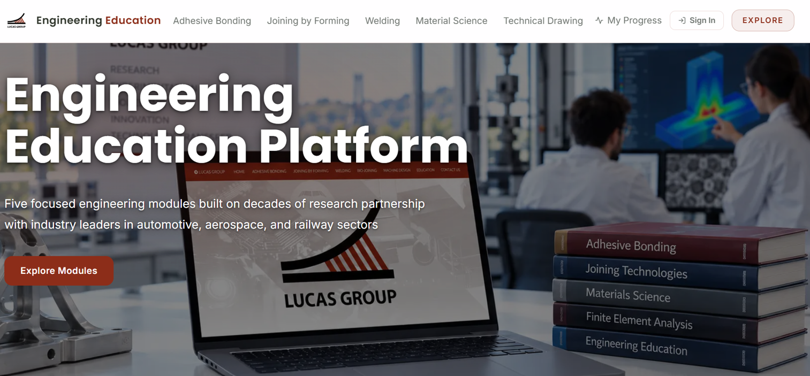
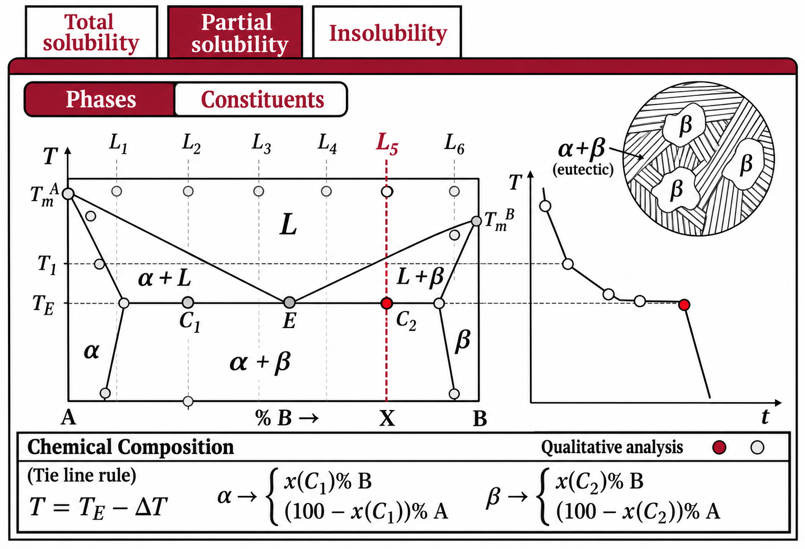
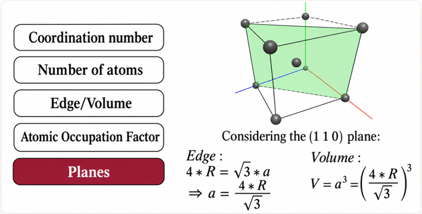
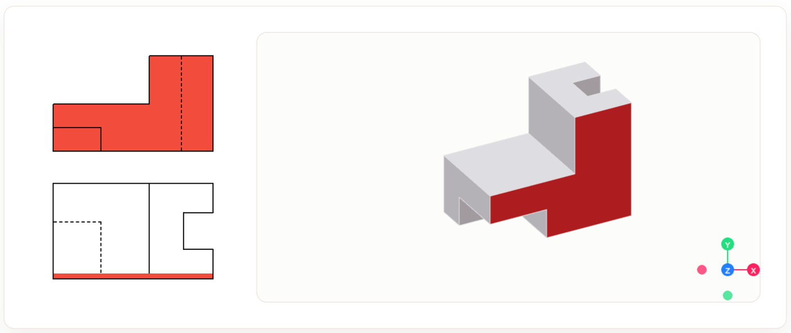
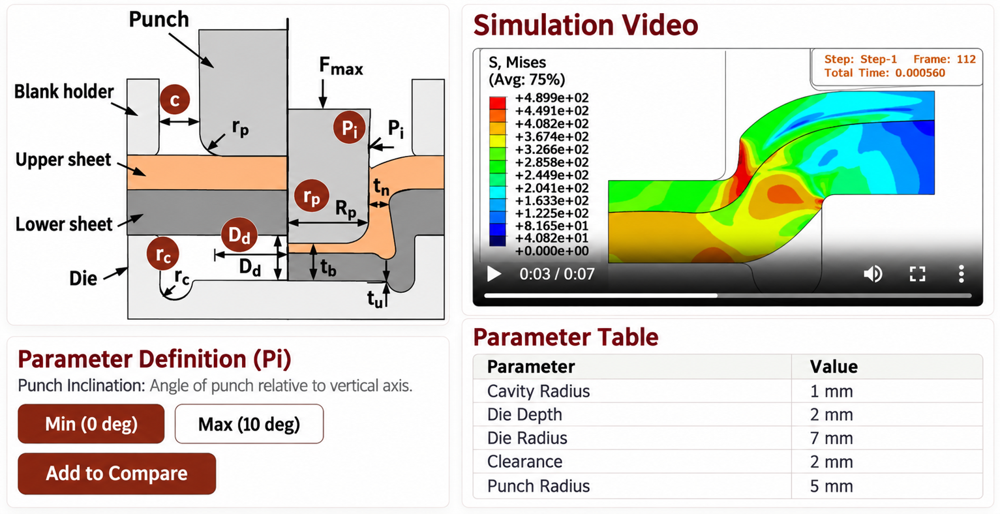
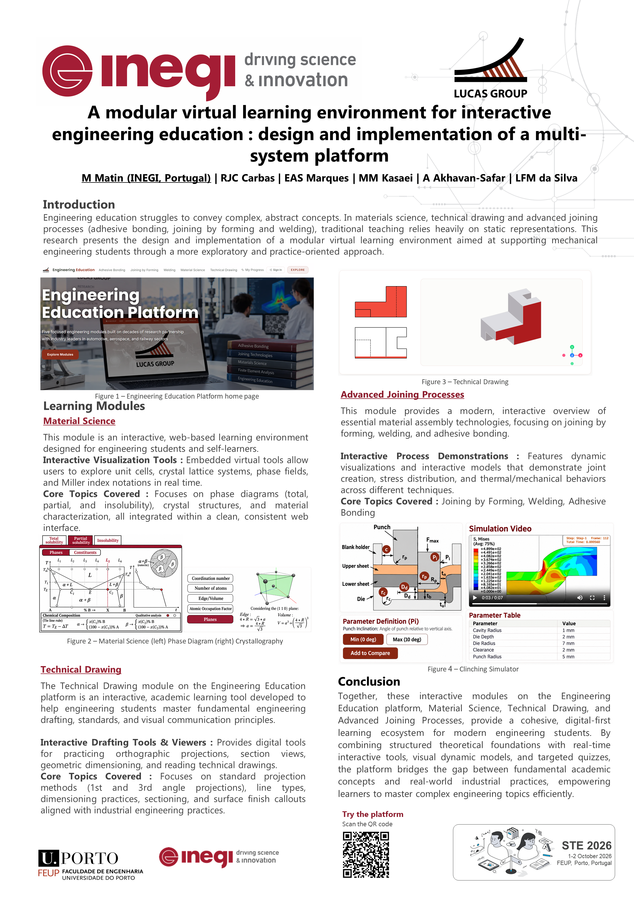

# Engineering Education Platform

An interactive learning platform for engineering topics in joining, materials, and technical drawing. Explore guided learning paths, visual explainers, simulations, and quizzes across five subject areas.

## Explore the Platform

| Home | Phase diagrams |
| --- | --- |
|  |  |

| Crystallography | Technical drawing |
| --- | --- |
|  |  |

| Clinching simulator |
| --- |
|  |

## Learning Areas

- **Adhesive Bonding** — joint design, manufacturing, surface preparation, and failure analysis.
- **Joining by Forming** — clinching, self-piercing riveting, and related forming processes.
- **Welding** — fusion and solid-state joining concepts, with interactive learning tools.
- **Material Science** — crystal structures, phase diagrams, and material behavior.
- **Technical Drawing** — engineering graphics, orthographic views, and projection.

The platform includes interactive visualizations and simulators, guided module paths, quizzes, and activity tracking. Learning activity and quiz scores are stored in the browser; they are not synced across devices.

## Run Locally

You will need Node.js and npm installed.

```bash
npm install
npm run dev
```

Open [http://localhost:5000](http://localhost:5000).

### Authentication Configuration

Supabase-backed authentication is optional. To enable it, add the following values to a local `.env.local` file:

```env
NEXT_PUBLIC_SUPABASE_URL=your_supabase_project_url
NEXT_PUBLIC_SUPABASE_ANON_KEY=your_supabase_anon_key
```

Keep `.env.local` out of version control and use the credentials for your own Supabase project.

## Project Poster

<details>
<summary>View the STE 2026 poster</summary>



</details>
